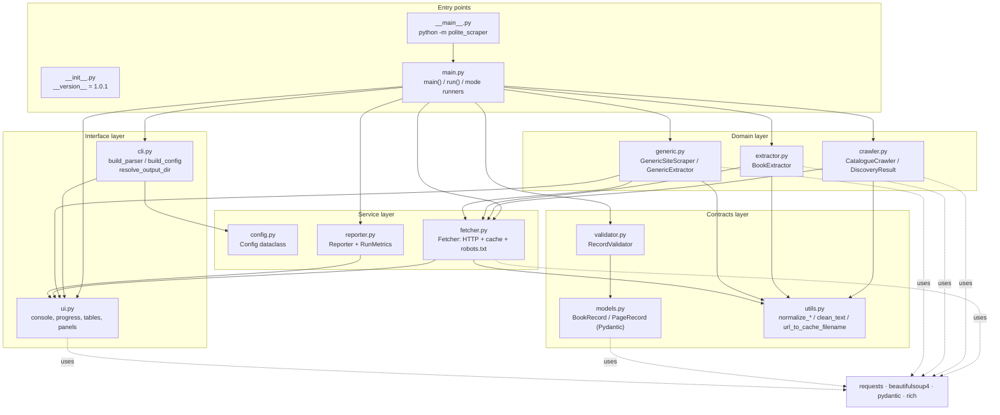

# 01 — Project Architecture

## 1. What The Polite Scraper does

The Polite Scraper is a command-line web scraper written in Python. You give it a website as a positional argument and it crawls that site — politely — and writes structured JSON records to disk.

```bash
polite-scraper https://books.toscrape.com
python -m polite_scraper https://quotes.toscrape.com --mode generic --pages 5
```

It has two concrete behaviors:

| Mode | What it produces | Implemented in |
|---|---|---|
| `book` | `books.json`: one record per product with title, price (raw + normalized float), availability (raw + structured), rating, description, source page, timestamp | `crawler.py` + `extractor.py` |
| `generic` | `pages.json`: one record per page with title, h1, meta description, headings, same-domain links, link/image/word counts | `generic.py` |

Each run writes into its own folder under `data/runs/<site-name>/` (`main.py` line 146–147, resolved by `cli.resolve_output_dir`), never overwriting a previous run.

## 2. The problem it solves

Scraping is usually taught as "download HTML, find the element". This project addresses the operational side of scraping that usually breaks in practice:

1. **Politeness** — a scraper can hammer a server. This one sends an identifying `User-Agent` (`config.py` line 7–10), enforces a minimum delay between live requests (`fetcher.py` line 70–75), consults `robots.txt` in generic mode (`generic.py` line 91–103), and accepts only HTTP 200 as success (`fetcher.py` line 84–89).
2. **Wasted bandwidth** — every fetched page is cached on disk (`fetcher.py` line 47), so a re-run makes **zero** network requests (verified: the README sample shows `0 network / 64 cache`).
3. **Dirty data** — scraped values are normalized (`utils.py`: price → float, rating → int, availability → dict) and validated against strict Pydantic schemas (`models.py`, `validator.py`). Bad records are quarantined into `errors.json` instead of crashing the run.
4. **Fragile pipelines** — one broken page fails alone (`main.py` line 98–105 catches per-item exceptions); the remaining pages still process.
5. **Run management** — repeated runs would overwrite results. Each run gets a website-derived, collision-safe output folder (`cli.py` line 137–179).

## 3. Main features (as verified in code)

- CLI with the target URL as the only required argument (`cli.py` `build_parser`, lines 31–99)
- Three modes: `book`, `generic`, and `auto` detection (`main.py` `resolve_mode_and_start`, lines 23–50)
- Disk cache with deterministic URL→filename mapping (`utils.py` `url_to_cache_filename`, lines 19–36)
- Rate limiting: min 500 ms between live HTTP requests, configurable via `--delay` (`fetcher.py` line 69–75)
- robots.txt handling via `urllib.robotparser` (`fetcher.py` `fetch_robots_txt` lines 50–67)
- Two Pydantic schemas: `BookRecord` (`models.py` line 5) and `PageRecord` (line 33)
- Unified validator producing `(record, error_details)` tuples (`validator.py`)
- Rich terminal UI: banner, progress bars, summary/files/error tables (`ui.py`)
- Verbose mode (`-v`) exposing per-request logs and raw-record checkpoints (`ui.py` `debug`/`checkpoint`)
- JSON run report via a dataclass `RunMetrics` serialized with `dataclasses.asdict` (`reporter.py` line 62–71)
- Broken-page simulation hook: `BROKEN_TEST_URL` env var (`config.py` line 32, checked in `extractor.py` line 26–27)

## 4. Overall architecture

The architecture is a **layered pipeline with dependency injection**:

- **Layer 1 — Interface**: `cli.py` (arguments → `Config`) and `ui.py` (all console output).
- **Layer 2 — Orchestration**: `main.py` coordinates the pipeline and owns the run lifecycle.
- **Layer 3 — I/O services**: `fetcher.py` (network + cache), `reporter.py` (files), `config.py` (settings/paths).
- **Layer 4 — Domain logic**: `crawler.py` + `extractor.py` (book mode), `generic.py` (generic mode).
- **Layer 5 — Contracts**: `models.py` (schemas), `validator.py` (enforcement), `utils.py` (pure helpers).

Key structural facts (verifiable):

- `Fetcher` is constructed **once** in `main.run` (line 150) and passed into the crawler, extractor, and generic scraper — all HTTP traffic flows through a single object with a single `requests.Session` (`fetcher.py` line 16), which is what makes the global rate limit work.
- The only module that talks to the network is `fetcher.py`. The only module that writes result files is `reporter.py`. The only modules that parse HTML are `crawler.py`, `extractor.py`, and `generic.py`.
- `ui.py` is imported by nearly every module (`main`, `cli`, `fetcher`, `generic`, `reporter`) — it is the shared output channel, not a component others call into for logic.

### Mermaid module relationship diagram

This diagram reflects actual imports (verified against every file):



## 5. Module responsibility table

| Module | Responsibility | Key public API |
|---|---|---|
| `main.py` | Orchestrate the run: mode resolution, crawl, extract, validate, report | `main()`, `run()`, `run_book_mode()`, `run_generic_mode()`, `resolve_mode_and_start()` |
| `cli.py` | Parse arguments, map to `Config`, resolve per-run output folder | `build_parser()`, `build_config()`, `resolve_output_dir()`, `derive_run_name()` |
| `config.py` | Single source of settings: UA, timeouts, delay, paths, toscrape special cases | `Config` dataclass, `toscrape_start_url()`, `ensure_directories()` |
| `fetcher.py` | The only network client: rate limiting, caching, status checks, robots.txt | `Fetcher.fetch()`, `Fetcher.fetch_robots_txt()` |
| `crawler.py` | Book mode: follow pagination, collect unique product URLs | `CatalogueCrawler.discover_books()`, `DiscoveryResult` |
| `extractor.py` | Book mode: parse detail pages, build + normalize records | `BookExtractor.extract_book()` |
| `generic.py` | Generic mode: BFS over same-domain links, page metadata extraction | `GenericSiteScraper.scrape()`, `GenericExtractor.extract_page()` |
| `models.py` | Data contracts (Pydantic v2) | `BookRecord`, `PageRecord` |
| `validator.py` | Enforce contracts, convert failures into error dicts | `RecordValidator.validate_record()`, `.validate_page()` |
| `reporter.py` | Persist books/pages/errors/report as JSON | `Reporter.save_books()`, `.save_pages()`, `.save_errors()`, `.save_report()` |
| `ui.py` | All terminal output: logs, progress, panels, tables | `debug/warn/info/error/success`, `banner`, `make_progress`, `*_table`, `checkpoint` |
| `utils.py` | Pure helper functions (no side effects) | `make_absolute_url`, `url_to_cache_filename`, `normalize_price/rating/availability`, `clean_text` |
| `__init__.py` | Package identity, version string | `__version__` |
| `__main__.py` | Enables `python -m polite_scraper` | imports and calls `main()` |

## 6. How the modules communicate

Communication happens through three mechanisms, each deliberate:

1. **Injected objects** — `main.run` creates `Config`, `Fetcher`, `Reporter` once and passes them into constructors (`crawler.py` line 15, `extractor.py` line 16, `generic.py` line 85, `reporter.py` line 29). Consequence: every fetch shares one session and one rate-limiter clock (`fetcher.py` `last_request_time`).
2. **Plain dicts as intermediate data** — crawlers/extractors produce raw dicts; validation converts them to Pydantic models. E.g. `extract_book` returns a dict (line 70–90), `RecordValidator.validate_record` turns it into a `BookRecord` (line 9–11).
3. **Module-level singleton** — `ui.py` holds one module-global `Console` (line 25) and a `_VERBOSE` flag (line 27). `main.run` sets it once (`set_verbose`, line 141); every other module just calls `ui.debug/info/...`.

Data hand-offs (exact sequence for book mode):

```text
cli.build_config ──► Config
resolve_mode_and_start ──► (mode, START_URL) written back into config (main.py line 153)
CatalogueCrawler.discover_books ──► DiscoveryResult.book_urls: list[dict]
BookExtractor.extract_book ──► raw dict (per URL)
RecordValidator.validate_record ──► BookRecord | (None, error dict)
main.run_book_mode accumulates ──► (validated_records, error_records)
Reporter.save_books/save_errors/save_report ──► JSON files in config.OUTPUT_DIR
ui.summary_table / files_table / errors_table ──► terminal panels
```

## 7. External libraries

| Library | Version floor | Where used | Purpose |
|---|---|---|---|
| `requests` | 2.31 | `fetcher.py` (Session, get), `extractor.py` (only to raise `HTTPError` for the test hook), `main.py` (catch `RequestException`) | HTTP client with session reuse |
| `beautifulsoup4` | 4.12 | `crawler.py`, `extractor.py`, `generic.py`, `main.py` (auto-detect probe) | HTML parsing + CSS selectors |
| `pydantic` | 2.0 | `models.py`, `validator.py` | Schema validation, `HttpUrl`, `field_validator` |
| `rich` | 13 | `ui.py` | Console rendering: `Console`, `Panel`, `Progress`, `Table`, `JSON` |

Parser choice is always `"html.parser"` (builtin) — no `lxml` dependency.

## 8. Important design decisions (fact vs. interpretation)

| Decision | Where | Status |
|---|---|---|
| Single shared `Fetcher`/`Session` so rate limiting is global | `main.py` 150, `fetcher.py` 14–22 | Fact: one clock; Interpretation: prevents per-component accidental hammering |
| Raw dicts as the interchange format, Pydantic only at the boundary | `extractor.py` → `validator.py` | Interpretation: keeps extraction simple; validation is a gate, not a transport |
| Errors as data, not exceptions, across the pipeline | `validator.py` 33–47, `main.py` 98–105 | Interpretation: lets one bad page fail without killing the run |
| Cache the raw HTML, not parsed data | `fetcher.py` 47 | Interpretation: extractor logic can change without re-downloading |
| Only HTTP 200 is success | `fetcher.py` 84–89 | Documented requirement from the original assignment ("Stage 1") |
| Per-run output folders derived from the site | `cli.py` 128–179 | Interpretation: run history becomes browseable evidence |
| `Config` reads env vars at **class-definition time** | `config.py` 7–12 | Fact: `os.getenv` runs at import; changing env later has no effect |
| `transient=True` progress bars | `ui.py` 76 | Fact: progress bars vanish on completion, leaving clean output |

### Verified gaps (things the code demonstrably does not do)

These are real, checked against the code — each is discussed in detail in [08_improvements_and_roadmap.md](08_improvements_and_roadmap.md):

1. **Book-mode discovery failures are unhandled**: `crawler.discover_books()` has no try/except and `run_book_mode` does not wrap it (`main.py` 58–61). A network error on the first catalogue page crashes the whole run with a traceback.
2. **`rating_int` and `availability_normalized` are computed then dropped**: `extract_book` adds them (lines 86–90) but `BookRecord` (`models.py` 5–14) has no such fields; Pydantic ignores unknown keys. They never reach `books.json`.
3. **Unused parameter**: `run_book_mode(config, fetcher, reporter)` and `run_generic_mode(...)` accept `reporter` but never use it (`main.py` 53, 113).
4. **Unused import**: `ui.py` imports `json` (line 8) but never uses it. `ui.is_verbose()` (line 35) is never called.
5. **Docstring drift**: `cli.derive_run_name` docstring says the result is `'books-toscrape'` (line 130) but the function returns `'books-toscrape-com'` (the TLD is kept; confirmed by `tests/test_scraper.py` line 135).
6. **robots.txt fetch bypasses the rate limiter** (`fetcher.py` 50–67 uses `self.session.get` directly) and is not counted in `network_fetches`.
7. **The `links_discovered` metric in `RunMetrics`** (`reporter.py` 18, computed at `main.py` 184) actually counts validated + failed + broken records, not links.

## 9. Project organization

```text
polite_scapper/
├── polite_scraper/           # the package (imported as polite_scraper)
│   ├── __init__.py           # version string only
│   ├── __main__.py           # python -m entry
│   ├── main.py               # orchestration
│   ├── cli.py                # arguments + run-folder naming
│   ├── config.py             # settings
│   ├── fetcher.py            # network I/O (single gateway)
│   ├── crawler.py            # book-mode discovery
│   ├── extractor.py          # book-mode parsing
│   ├── generic.py            # generic mode (crawl + parse)
│   ├── models.py             # Pydantic contracts
│   ├── validator.py          # contract enforcement
│   ├── reporter.py           # file output
│   ├── ui.py                 # terminal output
│   └── utils.py              # pure helpers
├── tests/test_scraper.py     # 10 offline tests
├── data/                     # cache/ (gitignored) + runs/<site>/
├── docs/                     # this documentation
├── pyproject.toml            # packaging (name polite-scraper, entry point)
└── requirements.txt
```

Packaging facts: distribution name `polite-scraper`, module `polite_scraper`, console script `polite-scraper = polite_scraper.main:main` (`pyproject.toml` `[project.scripts]`), version sourced from `polite_scraper.__version__` (`[tool.setuptools.dynamic]`).

---

Continue to [02_complete_data_flow.md](02_complete_data_flow.md) for the exact execution path.
