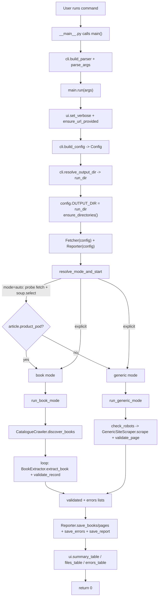
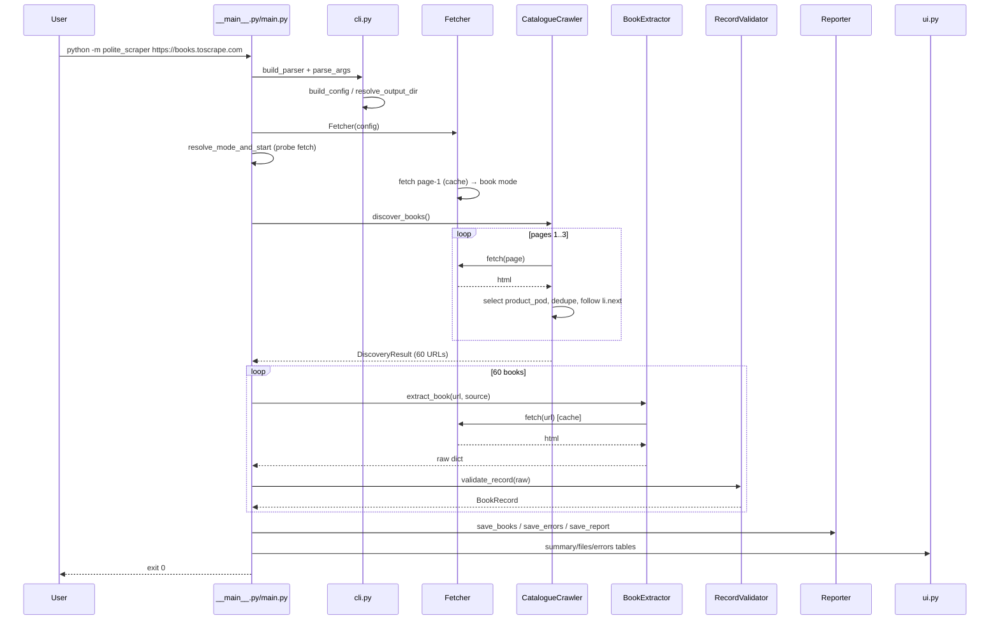

# 02 — Complete Data Flow

This document traces the *exact* execution path of a real run, from typing the command to the final JSON file. Every claim is tied to a file, function, and (where practical) line number in version 1.0.1.

Reference run used throughout:

```bash
python -m polite_scraper https://books.toscrape.com
```

## 0. Overview flowchart



## Stage 1 — Process start and package import

| | |
|---|---|
| **File** | `polite_scraper/__main__.py`, `polite_scraper/__init__.py` |
| **Trigger** | `python -m polite_scraper ...` |

Python's `-m` switch imports the package `polite_scraper` (executing `__init__.py`, which only defines `__version__ = "1.0.1"`), then executes `__main__.py` as `__main__`. That file does one thing:

```python
from polite_scraper.main import main          # __main__.py line 1

if __name__ == "__main__":                   # line 3 — True here
    raise SystemExit(main())
```

Importing `polite_scraper.main` triggers its module-level code, including the `sys.path` insert (`main.py` line 11) and all imports of `cli`, `ui`, `config`, etc. **No scraping has happened yet** — only definitions exist.

Alternative entry: the installed `polite-scraper` console script calls `polite_scraper.main:main` directly (declared in `pyproject.toml` `[project.scripts]`). Same target, no `__main__.py` involved.

## Stage 2 — Argument parsing

| | |
|---|---|
| **File** | `cli.py` `build_parser` (lines 31–99), `Parser.error` (22–28) |
| **Called by** | `main()` at `main.py` line 214 |
| **Input** | `sys.argv` |
| **Output** | `argparse.Namespace` with: `url, mode, pages, max_links, delay, timeout, force, verbose, version, name` |

Details:

- `url` is `nargs="?"` — optional at the parser level. "Is a URL actually required?" is enforced later, in `ensure_url_provided`.
- `--delay/--timeout` default to `None`, meaning "leave the env-var/default value alone" (`cli.py` 112–115).
- `--version` uses `action="version"` with `__version__` imported from the package (`cli.py` line 10, 90–93).
- On invalid arguments, the overridden `Parser.error` prints a red error plus `USAGE_EXAMPLES` and raises `SystemExit(2)` — argparse's own ugly usage dump never appears.

**Note:** `--help` and `--version` short-circuit inside argparse itself: they never reach `main.run`.

## Stage 3 — Early validation and configuration

| | |
|---|---|
| **Files** | `main.run` (lines 140–148), `cli.build_config` (102–125), `cli.ensure_url_provided` (182–192), `cli.resolve_output_dir` (137–179), `config.py` |
| **Input** | the `Namespace` |
| **Output** | a fully configured `Config` + resolved `run_dir` |

Execution order inside `run(args)`:

1. `ui.set_verbose(args.verbose)` — flips the module-global `_VERBOSE` flag in `ui.py` (line 30–32). This must happen before anything else or `ui.debug` output would be inconsistent.
2. `cli.ensure_url_provided(args)` — if `args.url` is falsy, prints "No website given." + examples, returns `False`; `run` returns exit code `2`. This is the *only* manual input validation: the URL scheme is normalized, not validated further.
3. `cli.build_config(args)`:
   - starts from a `Config()` dataclass (whose env-var defaults were already baked at import time — `config.py` lines 7–12 run `os.getenv` when the class is *defined*, not when instantiated);
   - URL handling: `example.com` → `https://example.com/` (scheme added if missing, trailing slash enforced — lines 106–110). No DNS or reachability check here;
   - `--pages/--max-links` are clamped to ≥ 1 (`max(1, ...)`, lines 116–118);
   - `env USER_AGENT` overrides the default UA, but CLI has no UA flag (line 121–123).
4. `cli.resolve_output_dir(config, args.name)`:
   - base name = `--name` or `derive_run_name(config.BASE_URL)`;
   - `derive_run_name` (128–134): takes `urlparse(url).netloc`, strips leading `www.`, replaces non-`[a-z0-9-]` with `-`. `books.toscrape.com` → `books-toscrape-com` (TLD kept — see test `test_derive_run_name`);
   - if `data/runs/<name>` does not exist → return it. If it exists: compute first free suffix `-1`, `-2`, ...; in a non-TTY session return suffixed path silently with an `ui.info`; on a TTY, prompt `New folder name [<auto>]:` in a loop — empty answer accepts the suffix, a free name wins, an existing name re-prompts (lines 170–179);
5. `config.OUTPUT_DIR = run_dir` (`main.py` 147) — this single assignment directs every later file write.
6. `config.ensure_directories()` — `mkdir(parents=True, exist_ok=True)` for `CACHE_DIR` and `OUTPUT_DIR` (`config.py` 38–40). Note: `OUTPUT_ROOT` is never mkdir'ed itself; the child `OUTPUT_DIR` creates the chain.

**If `resolve_output_dir` raised (e.g. permission error on mkdir) the run dies here — before any output panel is printed.**

## Stage 4 — Service construction

| | |
|---|---|
| **File** | `main.run` lines 150–151 |
| **Output** | `Fetcher` and `Reporter` instances |

```python
fetcher = Fetcher(config)     # fetcher.py 14–22
reporter = Reporter(config)   # reporter.py 29–30
```

`Fetcher.__init__` creates `requests.Session()` with the configured `User-Agent` header and zeroes the counters `cache_hits`, `network_fetches`, `last_request_time`. From this point, **all** subsequent HTTP traffic of the run shares this session and this delay clock.

## Stage 5 — Mode resolution

| | |
|---|---|
| **File** | `main.resolve_mode_and_start` (lines 23–50) |
| **Input** | `config`, `fetcher`, `args.mode` |
| **Output** | `(mode: str, start_url: str)`; `main` writes `start_url` back into `config.START_URL` (line 153) |

Logic:

- `is_toscrape_root = "books.toscrape.com" in given_url and path in ("", "/")` (line 33) — a substring check, so e.g. `notbooks.toscrape.com` also matches (an edge case; harmless in practice but worth knowing).
- `requested_mode == "book"` → return `("book", book_start)` where `book_start` is `<url>/catalogue/page-1.html` **only** when the user passed the toscrape root; otherwise the given URL itself.
- `requested_mode == "generic"` → return `("generic", given_url)`.
- `auto` (default): **probe fetch** `book_start` (line 43 — this goes through the full `Fetcher.fetch` path, cache included), parse with `BeautifulSoup(html, "html.parser")`, and check `soup.select("article.product_pod")` (line 49). Present → book mode; absent → generic with `start = given_url`.
- If the probe fetch raises `requests.RequestException` (connection refused, DNS failure, timeout, HTTPError for non-200): `ui.error` + `raise SystemExit(1)` (lines 44–46). **This is the only place a network failure is converted into a clean exit.**

## Stage 6 — Banner

`ui.banner(...)` (lines 155–162 → `ui.py` 80–96) prints the `Panel` with Target / Mode / Run folder / Max pages / Min delay / Cache. `run_timestamp` is captured *after* the probe fetch (`main.py` 164–165) — so the reported duration excludes mode detection.

## Stage 7 — Book-mode pipeline (`run_book_mode`, lines 53–110)

### 7a. Discovery

```python
discovery = crawler.discover_books()     # main.py 61 → crawler.py 19–59
```

`CatalogueCrawler.discover_books` is a while-loop over pagination:

1. `fetcher.fetch(current_url)` — cache first, else network (rate-limited).
2. `soup.select("article.product_pod")` — the book cards.
3. For each card: `pod.select_one("h3 a")["href"]` → `make_absolute_url(current_url, href)` (urljoin) → dedupe via `seen_urls` set → append `{"product_url": abs, "source_page": current_url}`.
4. `soup.select_one("li.next a")` — the pagination link; absent → `current_url = None`, loop ends.
5. Loop bounded by `MAX_CATALOGUE_PAGES` (`--pages`).

Output: `DiscoveryResult(catalogue_pages_count, discovered_count, book_urls)` — a plain class, not a dataclass, with three attributes (crawler.py 6–10).

**Verified gap:** `discover_books` performs no exception handling. If `fetcher.fetch` raises (e.g. first page is down, or a non-200 status), the exception propagates through `run_book_mode` → `run` → `main` and **crashes the process with a traceback**. Only KeyboardInterrupt is caught (`main.py` 218).

### 7b. Extraction + validation loop (lines 77–107)

For each entry in `discovery.book_urls`:

1. `extractor.extract_book(product_url, source_page)` (`extractor.py` 20–92):
   - `BROKEN_TEST_URL` hook: if the URL matches the env var, raises `HTTPError` immediately (line 26–27) — deterministic offline failure testing;
   - `fetcher.fetch(product_url)` → HTML;
   - selectors: `div.product_main` (required — `ValueError` if missing), `h1` → title, `p.price_color` → price text, `p.instock.availability` → availability, `p.star-rating` class list → rating word, `#product_description` + next `<p>` sibling → description (may be `None`);
   - normalization: `normalize_price` (raises `ValueError` on unparseable), `normalize_rating` (word → int, unknown → 0), `normalize_availability` (→ `{"in_stock", "quantity", "raw"}`);
   - returns the raw dict **including** `rating_int` and `availability_normalized` — which the Pydantic model will silently drop (see [models.md](modules/models.md), verified gap #2).
2. First-record checkpoint: the first successful extraction is pretty-printed as a JSON panel — but only when `-v` (lines 84–91; `ui.checkpoint` no-ops without verbose, `ui.py` 99–103).
3. `RecordValidator.validate_record(raw)` (`validator.py` 9–11 → `_validate` 18–47):
   - `BookRecord.model_validate(raw)` — title non-empty, `HttpUrl` fields parse, `price_gbp ≥ 0`, ISO-8601 `fetched_at`;
   - success → `(BookRecord, None)`; `ValidationError` → `(None, {product_url, reason, validation_errors, raw_record})`.
4. Accumulate into `validated_records` / `error_records`.
5. Any other exception (fetch failure, selector `ValueError`, normalize `ValueError`) → caught at line 98: `broken_pages += 1`, an error dict with `raw_record: None` is appended, the loop **continues**.
6. `finally: progress.advance(task)` — the progress bar ticks regardless of outcome.

After the loop: `ui.success(...)` and the function returns `(validated, errors, {"broken_pages": n})`.

## Stage 8 — Generic-mode pipeline (`run_generic_mode`, lines 113–137)

1. `scraper.check_robots(config.START_URL)` (`generic.py` 91–103):
   - `fetcher.fetch_robots_txt(base)` fetches `<scheme>://<netloc>/robots.txt` directly on the session — **bypassing rate limiting and cache, not counted in metrics** (verified gap #6). Any `RequestException` or non-200 → `None` → treated as "no rules" → allowed.
   - `RobotFileParser.can_fetch(USER_AGENT, start_url)` decides. `False` → `ui.error` + `SystemExit(1)` in main (line 118–119).
2. `scraper.scrape()` (`generic.py` 105–148) — BFS:
   - `queue = deque([start_url])`, `seen = {start_url.split("#")[0]}` (fragments stripped);
   - pop URL → `fetcher.fetch` (failure → error record, `continue` — and note: `pages_fetched` is **not** incremented on failure);
   - `extract_page` (lines 24–79): title from `<title>` falling back to `<h1>`; first h1; `meta[name=description]`; up to 10 non-empty headings; same-domain links (netloc equality on `urlparse`, scheme restricted to http/https, fragments stripped, per-page dedupe via `dict.fromkeys`, sample capped at 50); word count after decomposing `script/style/noscript`; image count; UTC `fetched_at`;
   - empty title → error record, page not saved as a valid record;
   - enqueue: for each same-domain link, if unseen and `_robots_allows(link)` → append to queue. The `max_links`/`max_pages` guard (line 141) is the odd-looking `if pages_fetched + len(queue) >= max_pages and len(queue) >= max_links: break`.
3. Validation loop in `run_generic_mode` (lines 130–135): `RecordValidator.validate_page(raw)` → `PageRecord` per record.

## Stage 9 — Persistence

| | |
|---|---|
| **File** | `reporter.py`; called at `main.py` 169/172/191/192 |

Order of writes (all into `config.OUTPUT_DIR`):

1. `save_books(validated)` or `save_pages(validated)` → `books.json` / `pages.json` — each record serialized via `r.model_dump(mode="json")` (this is where `HttpUrl` becomes a plain string and the dropped fields stay dropped), then `json.dump(..., indent=2, ensure_ascii=False)`.
2. `save_report(metrics)` → `run-report.json` via `dataclasses.asdict(RunMetrics)`.
3. `save_errors(errors)` → `errors.json` (always written, even if empty — an empty list `[]`).

`RunMetrics` construction (`main.py` 177–190): duration = wall clock of stages 7/8 only; `pages_crawled = cache_hits + network_fetches`; `links_discovered = validated + failed + broken` (naming caveat — it counts records processed, not links); all counters come off the single `Fetcher`.

## Stage 10 — Terminal summary

`ui.stage("Done")`, then three panels (`main.py` 194–208):

- `summary_table` — Target / Mode / Requests / Records saved / Failed / Duration;
- `files_table` — the three written paths;
- `errors_table` — first 5 errors in a red table, "... and N more" if longer.

`run` returns `0` **even when errors exist** (they are expected/handled outcomes). Exit codes in use: `0` success (with or without quarantined errors), `1` unreachable URL in auto-probe or robots-disallowed, `2` missing URL argument, `130` Ctrl-C, `2` argparse error (via `Parser.error`).

## Realistic execution example (book mode, warm cache)

```bash
$ python -m polite_scraper https://books.toscrape.com
```

1. `__main__.py` → `main()` → namespace built → `run(args)`.
2. `build_config`: BASE_URL = `https://books.toscrape.com/`, pages=3, delay=0.5, timeout=10.
3. `resolve_output_dir`: `data/runs/books-toscrape-com` — first run, no collision → created.
4. `Fetcher` ready; `resolve_mode_and_start`: toscrape root → `book_start = .../catalogue/page-1.html`; auto → probe fetch → cache hit (`catalogue-page-1.html` exists) → `product_pod` found → mode = **book**.
5. Banner printed. `run_book_mode`:
   - discovery: pages 1→2→3 fetched (all cache hits), 60 unique `product_url`s deduped, `li.next` missing on page 3 → stop.
   - extraction loop: 60 iterations; each `fetch` is a cache hit → **0 network requests total**; each record passes `BookRecord` validation → 60 records, 0 errors, 0 broken.
6. Persistence: `books.json` (60 records), `run-report.json`, `errors.json` (empty list).
7. Summary panels; exit 0. Total wall time ≈ 0.8 s — all of it BeautifulSoup parsing.



## Generic-mode walkthrough (short)

```bash
$ python -m polite_scraper https://quotes.toscrape.com --mode generic --pages 4
```

1. `resolve_output_dir` → `data/runs/quotes-toscrape-com`.
2. Mode is explicit `generic`; `START_URL = https://quotes.toscrape.com/`.
3. `check_robots`: `robots.txt` → 404 on this host → "no rules" → proceed.
4. `scrape()`: BFS — page 1 → 20+ same-domain links → up to 6 (`--max-links` default 8, here 6 in the sample run) enqueued; pages 2, 3, 4 similarly; each page becomes a raw dict; all have titles → 4 valid records.
5. `PageRecord` validation ×4 → `pages.json`, `run-report.json`, `errors.json`.

Cross-references: per-module detail in [modules/](modules/README.md); failure matrix in [05_error_handling.md](05_error_handling.md).
