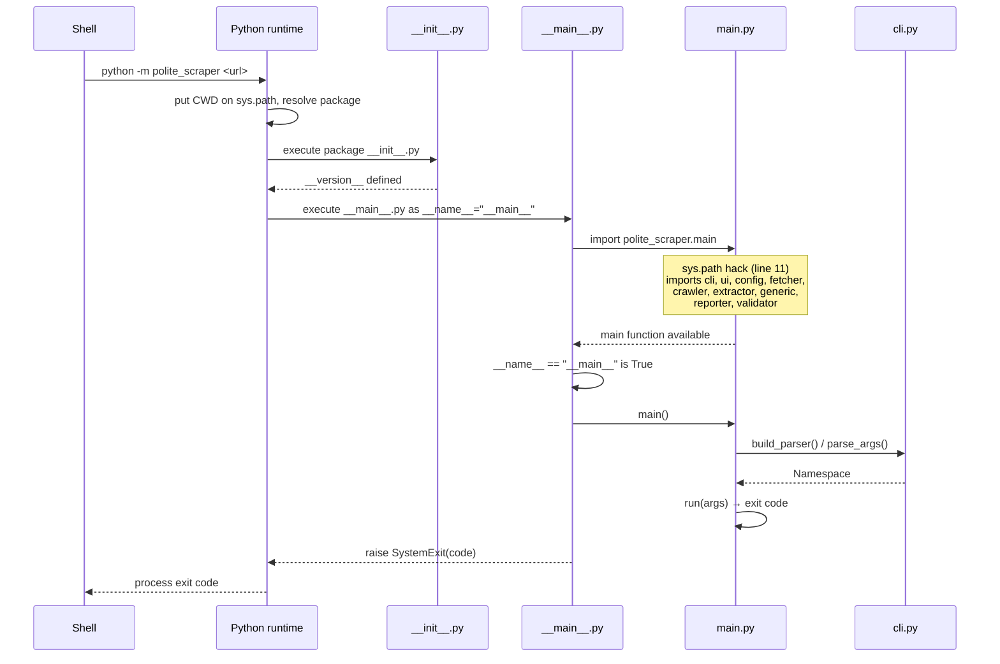

# 04 — Execution and Entry Points

This document explains how the program *starts*, using only the real code. Four files participate: `__init__.py`, `__main__.py`, `main.py`, `cli.py` (plus `pyproject.toml` for the installed entry point).

## 1. The four entry mechanisms

| You type | What Python does | Which file runs first as code |
|---|---|---|
| `polite-scraper <url>` (installed) | loads the console-script stub generated by pip/setuptools | the stub → calls `polite_scraper.main:main` |
| `python -m polite_scraper <url>` | imports package `polite_scraper`, then executes its `__main__.py` as `"__main__"` | `__init__.py`, then `__main__.py` |
| `python polite_scraper/main.py <url>` | executes `main.py` as `"__main__"`; its directory goes on `sys.path` | `main.py` (with its sys.path hack, line 11) |
| `import polite_scraper` (from tests) | executes `__init__.py` only | `__init__.py` — nothing else runs |

## 2. `__init__.py` — the package identity

```python
"""The Polite Scraper — a rate-limited, cache-first web scraper."""
__version__ = "1.0.1"
```

Executed on **every** import of anything under `polite_scraper.*`. Consumed by:
- `cli.py` line 10 (`from polite_scraper import __version__`) → the `--version` flag (line 90–93);
- `pyproject.toml` `[tool.setuptools.dynamic] version = { attr = "polite_scraper.__version__" }` → wheel metadata;
- the v1.0.1 PyPI release identity.

Deliberately dependency-free: importing the package must stay cheap (packaging tools import it during builds).

## 3. `__main__.py` — the `python -m` shim

```python
from polite_scraper.main import main          # line 1
if __name__ == "__main__":                    # line 3
    raise SystemExit(main())                  # line 4
```

Execution sequence for `python -m polite_scraper`:



## 4. `main.py` — the real entry logic

Two relevant spots:

1. **Module level (lines 1–20)**: imports + the path hack:
   ```python
   sys.path.insert(0, str(Path(__file__).resolve().parent.parent))  # line 11
   ```
   When you run `python polite_scraper/main.py` directly, `sys.path[0]` is the *package directory* (`polite_scraper/`), so `import polite_scraper.config` would fail — the hack prepends the *repo root* so the package import resolves. When run via `-m` or the console script, this line is redundant (the package is already importable) but harmless.

2. **The guard (lines 223–224)**:
   ```python
   if __name__ == "__main__":
       raise SystemExit(main())
   ```
   True only for the direct-script path. Via `python -m`, `main.py` is *imported* (as `polite_scraper.main`), so the guard is False — execution enters through `__main__.py` instead. The guard prevents double execution.

### `main()` itself (213–220)

```python
def main() -> int:
    parser = cli.build_parser()
    args = parser.parse_args()          # may SystemExit(2) via Parser.error, or exit 0/1 for --help/--version
    try:
        return run(args)                # the whole pipeline
    except KeyboardInterrupt:
        ui.warn("Interrupted — exiting")
        return 130
```

## 5. `cli.py` — executed *inside* the run

`cli` is not an entry point itself; `main()` calls `cli.build_parser()` and `run()` calls `cli.build_config()` / `cli.ensure_url_provided()` / `cli.resolve_output_dir()`. The one place `cli` triggers a process exit directly is the overridden `Parser.error` (line 28: `raise SystemExit(2)`) — which fires *inside* `parse_args()`, before `run()` ever starts.

## 6. Exit code contract (all entry points converge here)

| Code | Source | Trigger |
|---|---|---|
| `0` | `run()` line 210 | completed run (errors quarantined in `errors.json` still exit 0) |
| `1` | `resolve_mode_and_start` line 46 | auto-probe cannot fetch the target |
| `1` | `run_generic_mode` line 119 | robots.txt disallows |
| `2` | `cli.Parser.error` | invalid arguments |
| `2` | `run()` line 143 | no URL provided |
| `130` | `main()` line 220 | Ctrl-C |
| `1` | interpreter | unhandled exception (e.g. book-mode discovery network failure — verified unhandled) |

## 7. Import vs. execution — the concept

- **Importing** a module runs its top-level code once, caches it in `sys.modules`, and binds a name. Imports are for *definitions*.
- **Executing** a module (`python file.py`, `-m`) runs top-level code with `__name__ == "__main__"`. The guard is the convention for "behavior only when executed".

In this project the pattern appears three times:
- `__main__.py` line 3 (the `-m` entry),
- `main.py` line 223 (the direct-script entry),
- and notably *not* in any other module — `cli.py`, `fetcher.py`, etc. are pure import targets with no runnable behavior.

## 8. Two entry paths, one function — why that matters

The `polite-scraper` console script (pyproject `[project.scripts]` → `polite_scraper.main:main`) and `python -m polite_scraper` both end at the same `main()`. Consequences you can defend:

- Exit-code contract is identical regardless of entry point.
- `--version` is identical (`__version__` read from `__init__.py` in both cases).
- The only asymmetry: `python polite_scraper/main.py` needs the sys.path hack (line 11); the other two do not. If the project dropped direct-script support, line 11 could be deleted with no other changes.

Related: [modules/main_entry.md](modules/main_entry.md), [modules/init.md](modules/init.md), [modules/main.md](modules/main.md), [modules/cli.md](modules/cli.md).
